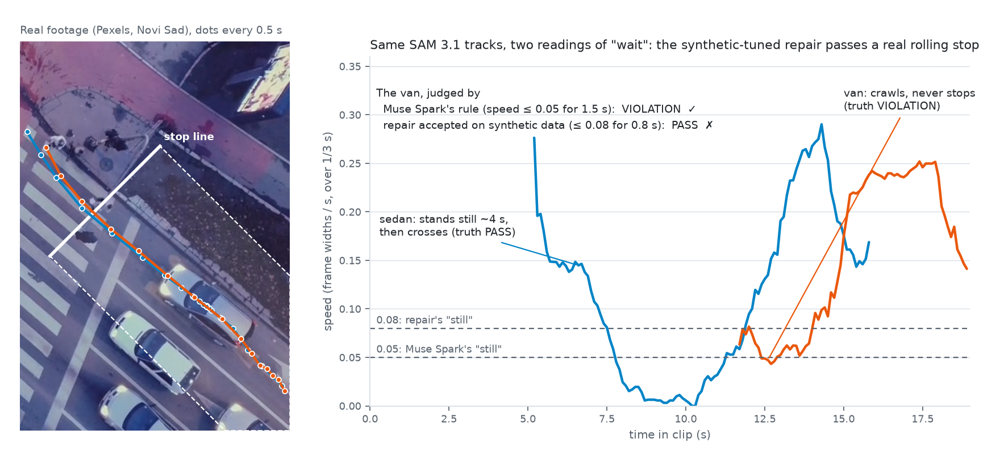
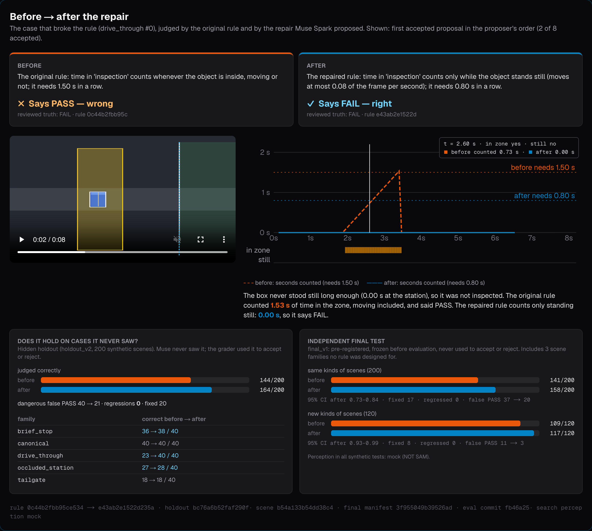
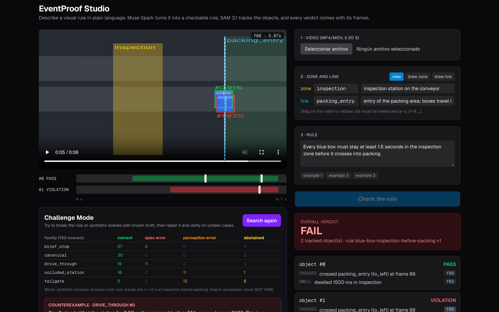

# EventProof

**Before an AI camera fines anyone, EventProof puts the rule, and every ticket, on trial.**

A city writes "every car must come to a full stop at the line", and an AI camera starts issuing $40 tickets. Detecting
the event is the easy half. EventProof answers the half nobody checks: **would this ticket hold up?**
- **Muse Spark** compiles the sentence, or the statute itself, into a video check.
- **SAM 3.1** tracks every car.
- **Muse Wonder** reads the sentence a second time.
- **EventProof** then attacks the rule and every ticket it issues, and keeps only what survives.

**One ticket.** A grey hatchback in Wroclaw drives through the stop line without ever stopping, and the camera tickets
it. The ticket is correct. Muse Spark, acting as the driver's lawyer, finds the one argument that wins: the rule never
says how slow counts as "stopped". Double that threshold and the ticket disappears. Across **20 real tickets from
labelled footage, only 4 hold up** against every challenge, and 11 of them rest on a number nobody wrote down.

**The law, as written.** Maryland's statute (where Takoma Park tickets) and California's say *"shall stop"* and contain
no digit. A camera still needs two numbers: how long to stand still, and how slow counts as "still". **Same law, same
30 real cars, same model: anywhere from 0 to 17 tickets**, depending only on those two numbers. Muse Spark picked
1.0 s at ≤ 0.05 frame widths/s (13 tickets, 25/30 right), and labelled 0.05 as "quoted" from the words "shall stop".

**Three numbers, all on labelled real footage, all pre-registered:**

| | |
|---|---|
| Real tickets that survive every challenge | **4 of 20** |
| Tickets the same law issues on the same 30 cars, depending on two unwritten numbers | **0 to 17** |
| Cars judged right by the rule Muse Spark compiled; by a repair that passed every synthetic test | **27/30 vs 16/30** |

**Who it is for.** Takoma Park, Maryland, issues $40 citations from AI stop-sign cameras, and Virginia allowed them in
April 2026. Such systems' claims are *"rarely backed up by independent studies"* (NYCLU, in IEEE Spectrum).
EventProof is that independent check, for the program manager who signs off on a camera rule and the reviewer who
approves each citation.

## How it works
1. **Compile.** Muse Spark turns the sentence, or the statute, into a typed rule. It never writes code, and every value
   is either quoted from the text or marked as assumed. SAM 3.1 tracks the objects, and a deterministic engine judges
   each one. Muse Wonder reads the sentence a second time; if the two readings differ, EventProof shows the scene that
   separates them.
2. **Attack.** Every ticket is judged again with the line a few pixels away, another measured point, thresholds ±20 %
   and another meaning of "stop". Muse Spark argues the defense from a closed menu, and the engine decides. Synthetic
   scenes with known truth find the smallest case that fools the rule, and a repair is kept only with zero regressions.
3. **Issue only what survives.** Robust tickets go out. Every other ticket is held for a human, together with the
   smallest change that would overturn it. Each rule gets a one-page certificate and a contract block a city can hand
   to its vendor; no model writes either.

The flagship is traffic, because that is where AI cameras fine people today. The same loop judges any zone, time,
direction or two-object rule: pedestrians, cyclists, umbrellas over heads, boxes on a conveyor.

## Why Meta models
- **Muse Spark** compiles rules through a small strict schema (about 1.4k prompt tokens). It escalates to a
  two-object schema only when a sentence needs one, picks where objects are measured, drafts zones from the first
  frame, argues the defense and proposes repairs.
- **Muse Wonder** is the independent second reading that exposes ambiguous sentences.
- **SAM 3.1** gives text-prompted video tracks with stable ids, with one extra prompt per second concept. It keeps
  overlapping boxes apart where a naive tracker merges them (10/10 tailgating scenes, against 2/10).
- The whole build spent about $12 of the $150 credits. Live calls need explicit allowances, and everything else replays
  from recorded responses.

**Try it.** A live studio runs on Vercel: pick a real clip, type a rule, see each object's verdict over the video in
about 30 s, then attack, repair and print the certificate; open **Ticket court** (20 real cases) and **Drag the law**. Locally, with no API key: `docker compose up`.



## Evidence in detail (labels frozen and pushed before any model call; CI recomputes every number)
| What was tested | Result |
|---|---|
| Real traffic, 5 clips from 2 cities (Novi Sad, Wroclaw), 30 labelled cars | Rule compiled by Muse Spark: **27/30 right, 0 wrong verdicts**. A repair that passed every synthetic test: **16/30**, it lets real rolling stops through. |
| Same clips, **Muse Spark alone** judging the video directly (5 runs per clip) | Clip verdicts right, but crossings and violations counted exactly in only **11/25** runs. |
| Every frozen real set with the current compiler: 10 clips, 46 objects (cars, pedestrians, cyclists; Serbia, Poland, Brazil, plus two clips of unstated location) | **38/46 right**, 3 wrong, 2 abstained, 3 never judged, as pre-registered. A later label audit found that 2 of the 3 "wrong" verdicts were our own labelling error, giving **40/46, 1 wrong** ([audit](benchmark/real/santos/label_audit.json)). |
| A bug found in the field: bike path in Santos, Brazil | First run **0/8**: the compiler measured riders at the box centre, which never reaches a line at the wheels. The new rule check flagged it, and the schema now lets Muse pick the point. Re-run: **5/8**, and 7/8 after the label audit. All runs are pre-registered and kept. |
| A rule typed live: *"remain behind the stop line for at least 2 seconds"* | Muse Spark **and** Muse Wonder both read it as "be present", not "stop". Certificate against the clip's labels: **NOT CERTIFIED (3/5)**. |
| **Drag the law** (same statutes, same 30 cars; every stop time 0–3 s × every "still" speed, 273 combinations, deterministic) | **0 to 17 tickets** depending only on the two unwritten numbers; Muse Spark's choice issues 13 (25/30 right); the best combinations reach 26/30. Studio page with sliders. [grid](benchmark/law/grid.json) |
| **Contract acceptance block** (policy: auto-issue only ROBUST tickets) | All 20 tickets: none wrongly issued after the label audit (1 with the pre-registered labels; 95 % upper bound 16 %). 4 are auto-issued, none wrong, but that is too few to promise anything (upper bound 49 %). To promise ≤ 2 % false tickets a city needs **188** labelled error-free tickets; ≤ 5 %: 73. |
| **The statute itself** (Md. Transp. § 21-707(a), Cal. Veh. Code § 22450(a), verbatim; every value QUOTED or ASSUMED, quotes verified) | Spark: **25/30 cars right** on both. The statutes contain no number, yet **14/30 verdicts hang on the stop time and "still" speed the model had to assume**; Spark even labelled 0.05 as "quoted" from the words "shall stop". Wonder failed 2/4 compiles. [findings](benchmark/law/FINDINGS.md) |
| **Would the tickets hold up?** 20 real tickets, each re-judged under about a dozen typed changes; Muse Spark as the defense | **4/20 survive everything**; 11 hang on the unwritten "stopped" threshold. Muse's defense won 8 of the 16 beatable tickets and conceded 3 of the 4 robust ones. It also conceded the ticket the pre-registered labels called wrongly issued; the label audit shows that ticket was correct. [findings](benchmark/tickets/FINDINGS.md) |
| Two readings, 8 phrasings of one rule (Spark vs Wonder, 150 scenes) | "wait" and "remain" are read differently (standing still vs just inside): verdicts differ on **45/150** scenes; the separating pair is found automatically. |
| Repair on synthetic scenes with known truth (hidden holdout 200, final test 320, evaluated once) | Holdout **144 → 164**, false PASS 40 → 21, 0 regressions; final test 141 → 158/200 and 109 → 117/120 on never-seen scene types; with real SAM 3.1 tracks (80 scenes) **71 → 76**, false PASS 5 → 0. |
| Two-object rule: *"every pedestrian … must hold an umbrella over their head"* (rainy crossing seen from above) | Muse escalated to the WITH event and SAM 3.1 tracked people and umbrellas separately: **2/4** (a neighbour's umbrella counted for a bare head). |

## The problem
An AI model can turn a sentence like "every car must wait 1.5 s before the stop line" into a working video check almost
instantly. It also silently picks an interpretation, and the choice decides the verdict:
- On **real drone footage of a crossing** (above), Muse Spark read "wait" as *standing still* and caught a van that
  crawls through without ever stopping. A repair that had passed every synthetic test read "still" as *slower than
  0.08 frame widths/s* and **let that real rolling stop pass**.
- In our recorded warehouse run, Muse Spark read "stay at least 1.5 s" as *"any motion allowed, not requiring stopped"*,
  so a box that never stops but drifts through inspection passes: a **false PASS**.

Both are the dangerous kind of error for compliance, safety and quality checks, and nobody sees them until they cost
something. The same loop serves anyone who deploys a visual rule (traffic enforcement, warehouse and production-line QA,
site safety): before a rule goes live, it shows where the rule is wrong, why, and whether a fix really generalizes.

Sources for the deployment facts above: [MoCo Show, 2026-01-07](https://mocoshow.com/?p=121089) and
[2025-12-08](https://mocoshow.com/?p=119749) (Takoma Park pilot, $40 fine, staff review of every citation);
[The Baltimore Banner, 2026-01-07](https://www.thebanner.com/community/transportation/artificial-intelligence-takoma-park-stop-RVZ4ACYBYREI3N2MEQ3IBJM76A/)
(87% violation rates in the city study); [WTVR](https://www.wtvr.com/news/local-news/ai-cameras-virginia-stop-signs-june-17-2026)
(Virginia SB84); [IEEE Spectrum, 2025-07-05](https://spectrum.ieee.org/ai-intersection-monitoring) (quote: Daniel Schwarz, NYCLU).

## What it does (details)
1. **Build.** Muse Spark compiles the sentence into a typed temporal rule (strict JSON schema, validated by Pydantic,
   never executed as code) and lists its assumptions. SAM 3.1 tracks every object in the video. A deterministic engine
   returns a verdict per object, with the decisive frames. Events: being in a zone, dwelling there (optionally only while
   standing still), crossing a line in a direction, and **WITH**: a relation to an object of a second concept (a hard hat
   *on top* of a worker, a person *near* a forklift) held for a duration. When a sentence needs a second object type,
   Muse Spark escalates to the WITH schema and SAM 3.1 tracks that concept with its own prompt.
   **Two readings:** Muse Wonder reads the same sentence independently. If the two rules behave differently, EventProof
   shows the smallest pair of scenes that separates them ("the box never stopped but was inside 1.53 s: PASS or FAIL?")
   and the user picks the meaning, instead of a model picking it silently.
   **Rule check:** before any verdict is trusted, the compiled rule is checked against the run's own tracks. If no
   object ever crosses a line at the point the model measures (box centre or bottom), while objects do cross it at
   the other point, the studio warns that the rule cannot see what it judges.
2. **Break.** Challenge Mode renders synthetic scenes whose truth is known (drive-through, brief stop, occlusion,
   tailgating) and searches for the smallest scene that fools the rule: a minimal pair of clips that differ in one
   factor, one judged wrong and one judged right. The failing scene is re-checked with real SAM 3.1 tracks to separate
   a wrong rule from wrong perception.
3. **Repair.** Muse Spark diagnoses the failure and proposes bounded patches (at most 3 operations on thresholds and
   conditions; no free-form code). It revises over up to 3 rounds using only visible development cases.
4. **Prove.** An independent grader accepts a patch only if it fixes the counterexample with **zero regressions** on a
   frozen hidden holdout. A third, pre-registered test set (including scene types no rule was designed for) is
   evaluated once, after every decision is recorded. Real labelled footage is the last check (it caught the repair above).
5. **Certify.** One printable page per rule (`/runs/<id>/certificate`, "Rule certificate" in the studio): the sentence,
   both readings and the one the reviewer chose, the counterexamples, hidden-holdout and final-test results, every
   labelled real clip it was checked on, model request ids and file hashes. Its status follows fixed rules: a wrong
   verdict on labelled footage → NOT CERTIFIED; an object perception never tracked → CONDITIONAL (perception gap); a
   repair with no field check yet → REPAIR CONDITIONAL; right on the labelled footage but fooled by synthetic scenes →
   CONDITIONAL (counterexamples found); a failed rule check → NOT CERTIFIED. No model writes it.



## All results on real footage
**Pooled over 5 real traffic clips (30 hand-labelled cars, 2 cities):** Muse Spark's rule → SAM 3.1 → engine judged
**27/30 cars right** (2 abstained, 1 car SAM 3.1 never tracked, **0 wrong verdicts**; Wilson 95 % 0.74–0.97). The repair
that passed every synthetic test: **16/30**. Muse Spark alone from the video: right clip verdict 25/25 runs, but counted
crossings and violations exactly in only 11/25. [pooled](benchmark/real/traffic_v3/FINDINGS.md) · first pooled result
(4 clips, 22/24 vs 13/24): [here](benchmark/real/traffic_v2/FINDINGS.md)

| Test | Result |
|---|---|
| **New domains, same engine** — pedestrians on a zebra crossing and cyclists on a bike lane (Pexels), one-way rules typed in plain English | Muse Spark compiled both to NOT CROSSES(wrong direction), stating how it mapped "left to right". **7/8 labelled objects right, 0 wrong verdicts** (1 person got no matching track). [findings](benchmark/real/domains/FINDINGS.md) |
| **Compiler fix from the field: the model picks where objects are measured** — every frozen real set re-run (10 clips, 46 labelled objects) | Muse Spark kept the box centre on the drone view and chose the ground point everywhere else. Right **34 → 38/46**, never judged **10 → 3**, Santos **0 → 5/8**, and the rule check now fires on no clip. But wrong verdicts went **0 → 3**: one car behind another in the footbridge view, and two Santos riders that cross 1.4 s apart, swapped. A label audit later traced the Santos pair to our own labels: the engine was right on both. This is why the certificate checks every rule on footage of its own scene. [findings](benchmark/real/anchor_v4/FINDINGS.md) |
| **New country, same rule shape** — a bike path in Santos, Brazil, 2 clips, 8 labelled crossings: *"Cyclists may cross the line on the bike path only toward the camera"* | **0/8.** Muse Spark got the direction right, but EventProof's compiler silently measured each rider at the box centre: its schema had no way to say where objects are measured. The camera looks along the path, so no centre ever reached the line drawn at the wheels, and every rider passed. EventProof now checks this against the tracks (a deterministic rule check). The studio says "the rule cannot see what it judges" and the certificate refuses. The check fires on these 2 runs and on no other recorded real run. A pre-registered re-run with the sentence saying "measure each rider where the wheels touch the path": **1/8**. Muse wrote that assumption, but the compiler schema has no field for it, so the rule still used the centre and the check refused it again. [findings](benchmark/real/santos/FINDINGS.md) |
| **Two-object rule on real footage** — *"Every pedestrian in the crossing zone must hold an umbrella over their head"* (Pexels, rainy crossing seen from above, 4 labelled people) | Muse Spark escalated to the WITH schema and SAM 3.1 tracked pedestrians and umbrellas separately. Overall FAIL as labelled; **2/4 right, 1 wrong, 1 not tracked**. The wrong one: a neighbour's umbrella touched a bare-headed man's box for 0.4 s, and Muse had chosen no minimum duration, a gap in the sentence that a model filled silently. [findings](benchmark/real/with_umbrella/FINDINGS.md) |
| **Field repair** — repair from real failures (Novi Sad), accept only with 0 regressions on another city (Wroclaw, 22 cars) **and** on the 200 synthetic hidden scenes | Muse Spark's 4 patches all fixed the real footage (Wroclaw **9 → 19/22**) but also moved "1.5 s" to "1.0 s", breaking 7 synthetic cases → all rejected. A grid patch (stillness ≤ 0.04/s, ≥ 0.8 s): Wroclaw 9 → 19/22, synthetic 164 → 166/200, 0 regressions in both → accepted. [findings](benchmark/field_repair/FINDINGS.md) |
| **Zones drafted by Muse Spark** from the first frame + rule text (5 real clips, 30 labelled cars) | Same verdicts as the hand-drawn zones on the drone view (8/8); on the footbridge view, with no painted stop line in frame, Muse placed a proxy line elsewhere (and once read the direction backwards): **20/30** vs 27/30 by hand. So the draft is shown with Muse's assumptions and the user confirms it. [findings](benchmark/layout/FINDINGS.md) |
| **New rule typed in the studio** (Novi Sad clip, *"remain behind the stop line for at least 2 seconds"*) | Muse Spark and Muse Wonder both read it as presence, not stopping (0/150 synthetic scenes where they differ). All 10 cars PASS, including the 2 that never stopped. Challenge Mode: 36/150 failures. Certificate vs the clip's frozen labels: **NOT CERTIFIED, 3/5**. [run](docs/evidence/runs/20261102T080747Z-6b0ae7d4) |
| **Traffic, Wroclaw** — footbridge view along the road; 2 clips, 16 labelled cars (6 wait at red, 10 drive through on green) | Muse Spark's rule: 14/16 (2 abstained). Synthetic-accepted repair: **6/16** — it passes all 10 cars that never stop, because far from the camera they move under its 0.08 frame-widths/s "still" threshold (perspective). [findings](benchmark/real/traffic_v2/FINDINGS.md) |
| **Traffic, full loop** — Pexels drone view of a crossing in Novi Sad; 2 clips, 6 labelled cars (2 stop, 2 roll through, 2 wait); 1 Muse + 2 SAM calls | Rule compiled by Muse Spark: **8/8 labelled objects right**, both clip verdicts right, incl. a real rolling stop. Same rule + the repair accepted on synthetic data: **7/8** — it passes the rolling stop. SAM 3.1 found every labelled car. [findings](benchmark/real/novisad/FINDINGS.md) |
| **Baseline: Muse Spark alone** — same 2 clips, rule and labels; Muse Spark watches the video and answers directly; 5 runs per clip | Overall verdict right in 10/10 runs (the red car is obvious), but crossings and violations counted right in only **5/10** — **0/5 on the clip with the rolling stop**. The rolling van is flagged in 1/5 runs, and in 3/5 runs it reports waiting cars as crossing. EventProof: 8/8 objects, deterministic, with evidence. [findings](benchmark/real/spark_alone/FINDINGS.md) |
| **Parcels, perception** — Pexels conveyor clip, 8 hand-labelled line crossings | One SAM 3.1 request on the full frame: **2/8** (it fills its 16-objects-per-frame cap at frame 0, later parcels get no track). Cropped to the belt, 5 s overlapping windows: **8/8**, 0 false, median 0.2 s from the label. [v1](benchmark/real/pexels/REPORT_pexels.md) · [v2](benchmark/real/pexels/REPORT_pexels_v2.md) |

## Results on synthetic scenes with known truth (recorded run `20261028T023754Z-a922b5bb`)
| Step | Result |
|---|---|
| Build | Rule compiled by Muse Spark; SAM 3.1 tracked both boxes (110/110 boxes matched on the reference clip, median IoU 1.00); verdict FAIL for the box that tailgated into packing at frame 88. |
| Break | 150 synthetic scenes → 44 failures. Clearest: a box that stood still 0.00 s but spent 1.84 s in the zone → rule says PASS, truth FAIL. Minimal pair on belt speed (0.1178 vs 0.1180). Real SAM 3.1 tracks confirm it: a rule error, not perception. |
| Repair | Muse Spark, 3 rounds, 8 patches. **2 accepted, 6 rejected** (1–26 holdout regressions each). Round 1 was too strict and rejected; the accepted patch counts time only while the box stands still (≤ 0.08 of the frame per second, ≥ 0.80 s). |
| Hidden holdout (200 scenes) | **144 → 164 correct**, dangerous false PASS 40 → 21, **0 regressions**. |
| Final test (pre-registered, 320 scenes, evaluated once) | Same scene types: **141 → 158 / 200**. Three scene types never seen before: **109 → 117 / 120**. 0 regressions. Accepted patches gained +17 on average vs. +7.3 for rejected ones: the grader's choices transfer. |
| **Two readings** (Muse Spark vs. Muse Wonder, 8 phrasings of the same rule, 150 scenes) | Both models compiled 6; same behaviour on 4; **"wait" and "remain" read differently** (Spark: standing still, Wonder: just inside) → verdicts differ on 45/150 scenes; minimal pair found automatically (belt speed 0.11777 vs 0.11797: 1.53 s vs 1.47 s inside). In the traffic scene Wonder also reads "wait" as standing still. [findings](benchmark/ambiguity/FINDINGS.md) |
| Same final test with **real SAM 3.1 tracks** (80 scenes, pre-registered, 80 live calls) | **71 → 76 / 80**, false PASS **5 → 0**, 0 regressions; the only errors left are 4 abstentions behind an occluder. SAM gets 10/10 tailgating scenes right where the mock tracker gets 2/10. |

Full comparison (hand-written rule, Muse rule, Muse repair, baseline grid repair): [`benchmark/REPORT.md`](benchmark/REPORT.md).
Final test protocol and results: [`benchmark/final/`](benchmark/final/) (SAM 3.1 pass: [`benchmark/final/sam_v1/`](benchmark/final/sam_v1/REPORT_sam_v1.md)).
Each recorded run has a hash-sealed evidence ledger (file hashes, model request ids, live vs. cached outputs) that anyone
can re-verify, and CI recomputes every number above from committed files (no video, no API key).



## Why Meta models
- **Muse Spark (`muse-spark-1.3`)** does the two reasoning-heavy jobs: rule compilation through a constant-size strict
  JSON schema (~1.4k prompt tokens; it refuses rules it cannot express, e.g. "workers must wear a helmet") and failure
  diagnosis + repair proposals.
- **Muse Wonder (`muse-wonder-1.0`)** gives an independent second reading of every rule through the same strict schema,
  so EventProof can detect ambiguous sentences and ask the user, instead of trusting one model's interpretation.
- **SAM 3.1 (`sam-3.1`)** gives text-prompted video tracks with stable ids. It keeps two overlapping boxes apart where
  a naive tracker merges them (5/5 tailgating cases right with SAM, 0/5 with the mock tracker) and confirms
  counterexamples on real tracks.
- Meta API spend for the whole build: at most about $6 of the $150 credits ($0.74 read from Billing before the real-footage
  and SAM final-test passes, plus their per-frame bounds). Live calls need explicit per-process allowances (default 0);
  everything else is served from a cache of recorded responses.

## Honest limits
- Real footage is small: 46 labelled objects in 10 clips with the current compiler (plus 4 people in the umbrella pilot
  and 8 parcels in a perception check), labelled by one person from frame sheets. It shows concrete failures and fixes;
  it is not an accuracy benchmark.
- The compiler fix that lets Muse pick where objects are measured judges more objects (never judged 10 → 3). As
  pre-registered, it added 3 wrong verdicts (0 → 3). A label audit traced 2 of them to our own labelling, so 1 remains.
  That is why the certificate checks each rule on labelled footage of its own scene.
- The large-scale evidence is synthetic (a conveyor world with scripted truth). Holdout and final scoring use a
  deterministic mock tracker; an 80-scene subset re-run with real SAM 3.1 tracks gives the same conclusion.
- Challenge Mode and two readings do not yet cover two-concept (WITH) rules; the studio says so.
- We tried to scale the evaluation with independent labels from MEVA (CC BY 4.0, 1,392 vehicle tracks). The design was
  invalid, because MEVA tracks span only each activity, so a 'start' track begins at rest. It is documented in
  [`benchmark/meva/FINDINGS.md`](benchmark/meva/FINDINGS.md) and not counted anywhere.
- Labels are hand-matched to tracks in crossing order; two objects crossing close together in opposite directions can
  be swapped. In Santos the cause was our own label times; it was found by an audit, and the pre-registered figures are
  kept next to the audited ones.

## Run it
```
docker compose up --build        # studio http://localhost:3000 · API http://localhost:8000/health
```
Replay the recorded run with no key and no credits (it ships in [`demo/`](demo/)):
`EVENTPROOF_ARTIFACTS=./demo/showcase docker compose up --build`, then open
`http://localhost:3000/?run=20261028T023754Z-a922b5bb`. For live runs put `MODEL_API_KEY` in `backend/.env` and allow
calls explicitly: `EVENTPROOF_MAX_LIVE_MUSE_CALLS=6 EVENTPROOF_MAX_LIVE_SAM_CALLS=3 docker compose up`.

Without Docker: `cd backend && uv sync && uv run pytest && uv run uvicorn eventproof.api.main:app` and
`cd frontend && npm ci && npm run dev`.

Engineering: FastAPI + Pydantic backend, Next.js studio, 289 backend tests + Playwright end-to-end tests in CI,
regression tests that recompute every published number, images pinned by digest. Showcase deployment (no key, no
uploads, rate-limited) in [`deploy/`](deploy/).

## Repository map
- `backend/eventproof/` — `meta/` (Muse Spark, SAM 3.1 clients), `engine/` (deterministic evaluator), `challenge/`
  (renderer, scene families, counterexample search), `repair/` (patches, proposers, grader), `validation/` (final test,
  real video), `ledger.py`
- `frontend/` — studio (upload, rule, zones, timeline, Challenge, before/after)
- `benchmark/` — holdout and final manifests, reports · `docs/` — evidence, decisions, protocols

## Team
Solo developer (Indie Developer track), built during the hackathon window (Oct 27 – Nov 4, 2026). See `docs/NEW_WORK.md`.

## License
MIT ([`LICENSE`](LICENSE)) for the code in this repository. Third-party components and media keep their own licenses
(`docs/compliance/LICENSE_INVENTORY.md`); the Pexels clips are not redistributed, only referenced by URL and sha256.
